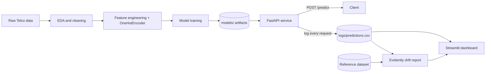

# ChurnGuard AI — Customer Churn Prediction with MLOps

[](https://github.com/chiraz-Ag/Churn-Prediction-MLops/actions/workflows/ci.yml)


A churn prediction project where I built the full pipeline around the model: data preparation, a FastAPI service, automated CI/CD, cloud deployment and data drift monitoring.

**Try it live:** [`/health`](https://churnguard-api-fj06.onrender.com/health) · **Dataset:** [IBM Telco Customer Churn](https://raw.githubusercontent.com/IBM/telco-customer-churn-on-icp4d/master/data/Telco-Customer-Churn.csv) (7,043 customers)

---

## Architecture



CI/CD: every push runs `lint (ruff)` → `test (pytest)` → `build (docker)` on GitHub Actions. The API is containerized and deployed on Render.

---

## Features

- **Exploratory Data Analysis**: data cleaning, duplicate removal, outlier handling, statistical tests (Chi², t-test)
- **Feature engineering**: tenure buckets, service counts, derived ratios, OneHotEncoder fitted on the training set only
- **Model serving**: FastAPI REST API with strict Pydantic request/response validation
- **Automated testing**: pytest suite for the API and the preprocessing logic
- **Containerization**: multi-stage, non-root Dockerfile with a healthcheck
- **CI/CD**: GitHub Actions pipeline (lint → test → build)
- **Cloud deployment**: hosted on Render
- **Monitoring**: every prediction is logged, and Evidently AI generates data drift reports
- **Dashboard**: Streamlit dashboard for live monitoring

---

## API

| Endpoint | Method | Description |
|---|---|---|
| `/health` | GET | Liveness check, returns the loaded model type |
| `/predict` | POST | Churn probability, prediction and risk level for one customer |

Try the live API:

```bash
curl -X POST "https://churnguard-api-fj06.onrender.com/predict" \
  -H "Content-Type: application/json" \
  -d '{
    "gender": "Female", "SeniorCitizen": 0, "Partner": "Yes", "Dependents": "No",
    "tenure": 1, "PhoneService": "No", "MultipleLines": "No phone service",
    "InternetService": "DSL", "OnlineSecurity": "No", "OnlineBackup": "Yes",
    "DeviceProtection": "No", "TechSupport": "No", "StreamingTV": "No",
    "StreamingMovies": "No", "Contract": "Month-to-month", "PaperlessBilling": "Yes",
    "PaymentMethod": "Electronic check", "MonthlyCharges": 29.85, "TotalCharges": 29.85
  }'
```

Example response:

```json
{
  "churn_prediction": "Yes",
  "churn_probability": 0.7898,
  "risk_level": "High"
}
```

`churn_prediction` is `Yes` when the probability is at least 0.5. `risk_level` is `Low` below 0.33, `Medium` below 0.66, and `High` above.

> If the service runs on a free Render plan, the first request after a period of inactivity may take a while while the container wakes up.

---

## Design decisions

- **No train/serve skew.** The API reuses the exact feature engineering of the data preparation notebook and the same fitted encoder, so the model receives data shaped like its training data.
- **No data leakage.** The OneHotEncoder is fitted on the training split only.
- **Fail fast at startup.** Model and encoder artifacts are loaded once when the server starts. If one is missing, the API stops with an explicit error listing the missing files.
- **Validation at the boundary.** Categorical fields are typed with `Literal`, so an unknown category is rejected with a 422 before it can reach the model.
- **Logging never breaks a prediction.** If writing to the log fails, the client still gets its prediction.
- **Drift detection that adapts.** Evidently automatically selects the statistical test per column (type and sample size), and the report script warns when fewer than 30 predictions are logged, because the result would not be reliable.

**Engineering note.** While building the monitoring, I found a bug in the encoding step: binary columns were detected from the values of a single request, so a multi-category column such as `OnlineSecurity` could be wrongly treated as Yes/No. The encoder then received unseen values and silently encoded them as zeros. Columns handled by the encoder are now excluded from that detection, and the predictions changed accordingly.

---

## Project structure

```
Churn-Prediction-MLops/
├── .github/workflows/ci.yml          # Lint, test, build pipeline
├── notebooks/
│   ├── eda_churnguard_v2.ipynb       # Data cleaning, EDA, statistical tests
│   ├── data_prep.ipynb               # Feature engineering, encoding, train/test split
│   └── train_churnguard.ipynb        # Model training
├── src/
│   └── api/
│       └── main.py                   # FastAPI app: /health, /predict, prediction logging
├── tests/
│   ├── test_api.py
│   └── test_preprocessing.py
├── monitoring/
│   ├── generate_reference.py         # Builds the raw reference dataset for drift detection
│   ├── drift_report.py               # Compares live predictions vs. reference with Evidently
│   ├── populate_test_logs.py         # Sends randomized requests to populate logs for testing
│   └── dashboard.py                  # Streamlit monitoring dashboard
├── models/                           # Trained model + preprocessing artifacts
├── data/                             # Datasets (CSV files are gitignored)
├── logs/                             # Live prediction logs (gitignored, created at runtime)
├── Dockerfile
├── pytest.ini
├── requirements.txt                  # Full development dependencies
└── requirements-api.txt              # Slim dependencies for the API / Docker image
```

---

## Getting started

### 1. Clone and set up the environment

```bash
git clone https://github.com/chiraz-Ag/Churn-Prediction-MLops.git
cd Churn-Prediction-MLops
python -m venv venv
venv\Scripts\Activate.ps1        # Windows
# source venv/bin/activate       # macOS/Linux
pip install -r requirements.txt
```

### 2. Prepare the data and train a model

Run, in order:
1. `notebooks/eda_churnguard_v2.ipynb`: produces `data/processed/telco_churn_cleaned.csv`
2. `notebooks/data_prep.ipynb`: produces the train/test splits and the encoder/feature artifacts in `models/`
3. `notebooks/train_churnguard.ipynb`: produces `models/best_model.joblib`

### 3. Run the API locally

```bash
uvicorn src.api.main:app --reload
```

Interactive docs (Swagger UI): [http://127.0.0.1:8000/docs](http://127.0.0.1:8000/docs)

### 4. Run with Docker

```bash
docker build -t churnguard-api .
docker run -p 8000:8000 churnguard-api
```

### 5. Run the tests

```bash
pytest
```

---

## Monitoring and drift detection

The monitoring answers one question: does live traffic still look like the data the model was trained on?

```bash
# 1. Build the reference dataset (the historical customer population)
python monitoring/generate_reference.py

# 2. (Optional) populate logs/predictions.csv with sample traffic for testing
python monitoring/populate_test_logs.py

# 3. Generate a drift report comparing logs/predictions.csv to the reference
python monitoring/drift_report.py
# -> writes monitoring/reports/drift_report.html
```

Live dashboard (prediction volume, churn rate, probability distribution, and a button to regenerate the drift report):

```bash
streamlit run monitoring/dashboard.py
```

---

## Known limitations and roadmap

- **Persistent logging.** Predictions are logged to a CSV file, which is fine locally but not durable on a container platform. Next step: a database or object storage.
- **Continuous deployment.** The pipeline builds the Docker image but does not push it to a registry. Next step: publish the image and deploy automatically from CI.
- **Automated drift checks.** Drift reports are generated on demand. Next step: run them on a schedule and alert when too many columns drift.
- **Retraining.** Retraining is manual. Next step: trigger it when drift or performance degradation is detected.
- **API hardening.** Next step: authentication and rate limiting.

---

## Tech stack

Python · FastAPI · Pydantic · scikit-learn · pandas · Evidently AI · Streamlit · Docker · GitHub Actions · pytest · ruff · Render

---

